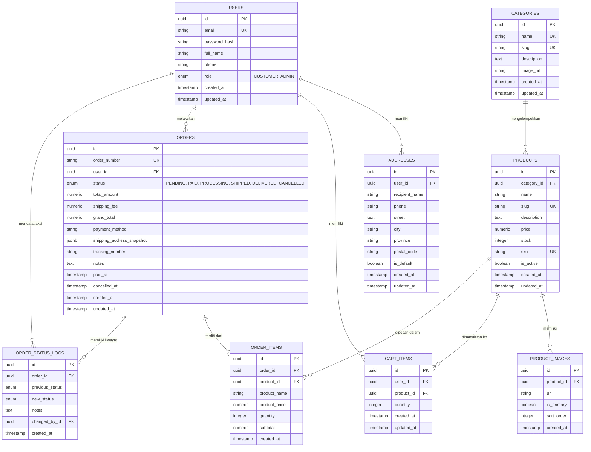

# Entity Relationship Diagram (ERD) & Database Schema
## Proyek: E-Commerce MVP (PostgreSQL + Prisma ORM)

| Dokumen Versi | 1.0.0 |
| :--- | :--- |
| Status | Menunggu Persetujuan (Pending Review) |
| Database Engine | PostgreSQL 15+ |
| ORM | Prisma ORM |

---

## 1. Visualisasi Diagram Relasi Entitas (Mermaid ERD)



---

## 2. Rincian Kamus Data (Data Dictionary)

### 2.1. Tabel `users`
Menyimpan identitas pengguna (pelanggan maupun administrator).
- `id` (UUID, Primary Key, Default: `gen_random_uuid()`): Identifier unik user.
- `email` (VARCHAR(255), Unique, Not Null, Indexed): Alamat email untuk autentikasi.
- `password_hash` (TEXT, Not Null): Hash password (Argon2 / bcrypt).
- `full_name` (VARCHAR(150), Not Null): Nama lengkap pengguna.
- `phone` (VARCHAR(30), Nullable): Nomor kontak seluler.
- `role` (ENUM: `'CUSTOMER'`, `'ADMIN'`, Default: `'CUSTOMER'`): Hak akses sistem.
- `created_at` (TIMESTAMPTZ, Default: `NOW()`): Waktu pendaftaran.
- `updated_at` (TIMESTAMPTZ, Default: `NOW()`): Waktu pembaruan profil.

### 2.2. Tabel `addresses`
Menyimpan buku alamat pengguna untuk pengiriman.
- `id` (UUID, Primary Key, Default: `gen_random_uuid()`).
- `user_id` (UUID, FK -> `users.id`, ON DELETE CASCADE): Pemilik alamat.
- `recipient_name` (VARCHAR(150), Not Null): Nama penerima paket.
- `phone` (VARCHAR(30), Not Null): Telepon penerima paket.
- `street` (TEXT, Not Null): Alamat lengkap (jalan, nomor rumah, RT/RW).
- `city` (VARCHAR(100), Not Null): Kota/Kabupaten.
- `province` (VARCHAR(100), Nullable): Provinsi.
- `postal_code` (VARCHAR(20), Not Null): Kode pos.
- `is_default` (BOOLEAN, Default: `false`): Penanda alamat utama pengguna.
- `created_at` & `updated_at` (TIMESTAMPTZ).

### 2.3. Tabel `categories`
Menyimpan pengelompokan produk.
- `id` (UUID, Primary Key, Default: `gen_random_uuid()`).
- `name` (VARCHAR(100), Unique, Not Null): Nama kategori (misal: "Elektronik", "Pakaian").
- `slug` (VARCHAR(120), Unique, Not Null, Indexed): Slug ramah SEO (misal: "elektronik").
- `description` (TEXT, Nullable): Keterangan kategori.
- `image_url` (VARCHAR(500), Nullable): Banner/ikon kategori.
- `created_at` & `updated_at` (TIMESTAMPTZ).

### 2.4. Tabel `products`
Menyimpan katalog inventaris barang yang dijual.
- `id` (UUID, Primary Key, Default: `gen_random_uuid()`).
- `category_id` (UUID, FK -> `categories.id`, ON DELETE RESTRICT): Kategori produk.
- `name` (VARCHAR(255), Not Null): Nama produk.
- `slug` (VARCHAR(280), Unique, Not Null, Indexed): Slug unik untuk URL detail produk.
- `description` (TEXT, Not Null): Deskripsi lengkap produk.
- `price` (DECIMAL(12, 2), Not Null, Check: `price >= 0`): Harga jual satuan (Rupiah).
- `stock` (INTEGER, Not Null, Default: 0, Check: `stock >= 0`): Sisa stok inventaris.
- `sku` (VARCHAR(100), Unique, Not Null): Stock Keeping Unit untuk identifikasi unik barang.
- `is_active` (BOOLEAN, Default: `true`, Indexed): Penanda produk dapat dilihat/dibeli pembeli.
- `created_at` & `updated_at` (TIMESTAMPTZ).

### 2.5. Tabel `product_images`
Menyimpan multi-gambar untuk satu produk.
- `id` (UUID, Primary Key, Default: `gen_random_uuid()`).
- `product_id` (UUID, FK -> `products.id`, ON DELETE CASCADE): Produk terkait.
- `url` (VARCHAR(500), Not Null): URL gambar.
- `is_primary` (BOOLEAN, Default: `false`): Gambar sampul utama.
- `sort_order` (INTEGER, Default: 0): Urutan tampilan gambar.
- `created_at` (TIMESTAMPTZ).

### 2.6. Tabel `cart_items`
Menyimpan produk yang dimasukkan pengguna ke keranjang belanja.
- `id` (UUID, Primary Key, Default: `gen_random_uuid()`).
- `user_id` (UUID, FK -> `users.id`, ON DELETE CASCADE): Pemilik keranjang.
- `product_id` (UUID, FK -> `products.id`, ON DELETE CASCADE): Produk yang dipilih.
- `quantity` (INTEGER, Not Null, Check: `quantity > 0`): Jumlah yang ingin dibeli.
- `created_at` & `updated_at` (TIMESTAMPTZ).
- *Constraint*: `UNIQUE(user_id, product_id)` memastikan 1 produk hanya 1 baris per user.

### 2.7. Tabel `orders`
Menyimpan transaksi pemesanan utama.
- `id` (UUID, Primary Key, Default: `gen_random_uuid()`).
- `order_number` (VARCHAR(50), Unique, Not Null, Indexed): Nomor invoice publik (misal: `ORD-20261020-0012`).
- `user_id` (UUID, FK -> `users.id`, ON DELETE RESTRICT): Pembeli.
- `status` (ENUM: `'PENDING'`, `'PAID'`, `'PROCESSING'`, `'SHIPPED'`, `'DELIVERED'`, `'CANCELLED'`, Default: `'PENDING'`, Indexed): Status siklus pesanan.
- `total_amount` (DECIMAL(12, 2), Not Null): Total harga produk belanjaan.
- `shipping_fee` (DECIMAL(12, 2), Not Null, Default: 0): Biaya kirim.
- `grand_total` (DECIMAL(12, 2), Not Null): Total tagihan (`total_amount + shipping_fee`).
- `payment_method` (VARCHAR(50), Not Null): Metode pembayaran yang dipilih.
- `shipping_address_snapshot` (JSONB, Not Null): Snapshot alamat tujuan saat pemesanan dibuat (kebal dari perubahan alamat di master).
- `tracking_number` (VARCHAR(100), Nullable): Nomor resi kurir.
- `notes` (TEXT, Nullable): Catatan pembeli.
- `paid_at` (TIMESTAMPTZ, Nullable): Waktu status berubah menjadi `PAID`.
- `cancelled_at` (TIMESTAMPTZ, Nullable): Waktu status berubah menjadi `CANCELLED`.
- `created_at` & `updated_at` (TIMESTAMPTZ).

### 2.8. Tabel `order_items`
Rincian item produk dalam sebuah pesanan.
- `id` (UUID, Primary Key, Default: `gen_random_uuid()`).
- `order_id` (UUID, FK -> `orders.id`, ON DELETE CASCADE): Pesanan induk.
- `product_id` (UUID, FK -> `products.id`, ON DELETE RESTRICT): Referensi produk master.
- `product_name` (VARCHAR(255), Not Null): Nama produk saat dipesan (snapshot).
- `product_price` (DECIMAL(12, 2), Not Null): Harga produk satuan saat dipesan (snapshot).
- `quantity` (INTEGER, Not Null, Check: `quantity > 0`): Jumlah barang.
- `subtotal` (DECIMAL(12, 2), Not Null): Subtotal kalkulasi (`product_price * quantity`).
- `created_at` (TIMESTAMPTZ).

### 2.9. Tabel `order_status_logs`
Catatan jejak audit (audit trail) setiap perubahan status pesanan.
- `id` (UUID, Primary Key, Default: `gen_random_uuid()`).
- `order_id` (UUID, FK -> `orders.id`, ON DELETE CASCADE): Pesanan terkait.
- `previous_status` (ENUM `OrderStatus`, Nullable): Status sebelum perubahan.
- `new_status` (ENUM `OrderStatus`, Not Null): Status setelah perubahan.
- `notes` (TEXT, Nullable): Keterangan admin (misal: "Resi: JNE-99882233").
- `changed_by_id` (UUID, FK -> `users.id`, ON DELETE SET NULL, Nullable): Petugas/pengguna yang memicu perubahan.
- `created_at` (TIMESTAMPTZ, Default: `NOW()`).

---

## 3. Draft Lengkap Skema Prisma (`packages/database/prisma/schema.prisma`)

Berikut adalah spesifikasi skema Prisma yang siap digunakan saat fase implementasi:

```prisma
datasource db {
  provider = "postgresql"
  url      = env("DATABASE_URL")
}

generator client {
  provider = "prisma-client-js"
}

enum Role {
  CUSTOMER
  ADMIN
}

enum OrderStatus {
  PENDING
  PAID
  PROCESSING
  SHIPPED
  DELIVERED
  CANCELLED
}

model User {
  id           String      @id @default(uuid())
  email        String      @unique
  passwordHash String      @map("password_hash")
  fullName     String      @map("full_name") @db.VarChar(150)
  phone        String?     @db.VarChar(30)
  role         Role        @default(CUSTOMER)
  createdAt    DateTime    @default(now()) @map("created_at")
  updatedAt    DateTime    @updatedAt @map("updated_at")

  addresses    Address[]
  cartItems    CartItem[]
  orders       Order[]
  statusLogs   OrderStatusLog[]

  @@map("users")
}

model Address {
  id            String   @id @default(uuid())
  userId        String   @map("user_id")
  recipientName String   @map("recipient_name") @db.VarChar(150)
  phone         String   @db.VarChar(30)
  street        String   @db.Text
  city          String   @db.VarChar(100)
  province      String?  @db.VarChar(100)
  postalCode    String   @map("postal_code") @db.VarChar(20)
  isDefault     Boolean  @default(false) @map("is_default")
  createdAt     DateTime @default(now()) @map("created_at")
  updatedAt     DateTime @updatedAt @map("updated_at")

  user          User     @relation(fields: [userId], references: [id], onDelete: Cascade)

  @@index([userId])
  @@map("addresses")
}

model Category {
  id          String    @id @default(uuid())
  name        String    @unique @db.VarChar(100)
  slug        String    @unique @db.VarChar(120)
  description String?   @db.Text
  imageUrl    String?   @map("image_url") @db.VarChar(500)
  createdAt   DateTime  @default(now()) @map("created_at")
  updatedAt   DateTime  @updatedAt @map("updated_at")

  products    Product[]

  @@index([slug])
  @@map("categories")
}

model Product {
  id          String         @id @default(uuid())
  categoryId  String         @map("category_id")
  name        String         @db.VarChar(255)
  slug        String         @unique @db.VarChar(280)
  description String         @db.Text
  price       Decimal        @db.Decimal(12, 2)
  stock       Int            @default(0)
  sku         String         @unique @db.VarChar(100)
  isActive    Boolean        @default(true) @map("is_active")
  createdAt   DateTime       @default(now()) @map("created_at")
  updatedAt   DateTime       @updatedAt @map("updated_at")

  category    Category       @relation(fields: [categoryId], references: [id], onDelete: Restrict)
  images      ProductImage[]
  cartItems   CartItem[]
  orderItems  OrderItem[]

  @@index([categoryId])
  @@index([slug])
  @@index([isActive])
  @@map("products")
}

model ProductImage {
  id        String   @id @default(uuid())
  productId String   @map("product_id")
  url       String   @db.VarChar(500)
  isPrimary Boolean  @default(false) @map("is_primary")
  sortOrder Int      @default(0) @map("sort_order")
  createdAt DateTime @default(now()) @map("created_at")

  product   Product  @relation(fields: [productId], references: [id], onDelete: Cascade)

  @@index([productId])
  @@map("product_images")
}

model CartItem {
  id        String   @id @default(uuid())
  userId    String   @map("user_id")
  productId String   @map("product_id")
  quantity  Int      @default(1)
  createdAt DateTime @default(now()) @map("created_at")
  updatedAt DateTime @updatedAt @map("updated_at")

  user      User     @relation(fields: [userId], references: [id], onDelete: Cascade)
  product   Product  @relation(fields: [productId], references: [id], onDelete: Cascade)

  @@unique([userId, productId])
  @@index([userId])
  @@map("cart_items")
}

model Order {
  id                     String           @id @default(uuid())
  orderNumber            String           @unique @map("order_number") @db.VarChar(50)
  userId                 String           @map("user_id")
  status                 OrderStatus      @default(PENDING)
  totalAmount            Decimal          @map("total_amount") @db.Decimal(12, 2)
  shippingFee            Decimal          @default(0) @map("shipping_fee") @db.Decimal(12, 2)
  grandTotal             Decimal          @map("grand_total") @db.Decimal(12, 2)
  paymentMethod          String           @map("payment_method") @db.VarChar(50)
  shippingAddressSnapshot Json            @map("shipping_address_snapshot")
  trackingNumber         String?          @map("tracking_number") @db.VarChar(100)
  notes                  String?          @db.Text
  paidAt                 DateTime?        @map("paid_at")
  cancelledAt            DateTime?        @map("cancelled_at")
  createdAt              DateTime         @default(now()) @map("created_at")
  updatedAt              DateTime         @updatedAt @map("updated_at")

  user                   User             @relation(fields: [userId], references: [id], onDelete: Restrict)
  items                  OrderItem[]
  statusLogs             OrderStatusLog[]

  @@index([userId])
  @@index([orderNumber])
  @@index([status])
  @@index([createdAt])
  @@map("orders")
}

model OrderItem {
  id           String   @id @default(uuid())
  orderId      String   @map("order_id")
  productId    String   @map("product_id")
  productName  String   @map("product_name") @db.VarChar(255)
  productPrice Decimal  @map("product_price") @db.Decimal(12, 2)
  quantity     Int
  subtotal     Decimal  @db.Decimal(12, 2)
  createdAt    DateTime @default(now()) @map("created_at")

  order        Order    @relation(fields: [orderId], references: [id], onDelete: Cascade)
  product      Product  @relation(fields: [productId], references: [id], onDelete: Restrict)

  @@index([orderId])
  @@map("order_items")
}

model OrderStatusLog {
  id             String       @id @default(uuid())
  orderId        String       @map("order_id")
  previousStatus OrderStatus? @map("previous_status")
  newStatus      OrderStatus  @map("new_status")
  notes          String?      @db.Text
  changedById    String?      @map("changed_by_id")
  createdAt      DateTime     @default(now()) @map("created_at")

  order          Order        @relation(fields: [orderId], references: [id], onDelete: Cascade)
  changedBy      User?        @relation(fields: [changedById], references: [id], onDelete: SetNull)

  @@index([orderId])
  @@map("order_status_logs")
}
```

---

## 4. Strategi Indeks & Optimasi Performa Database

1. **Pencarian & Katalog**:
   - `products.is_active` + `products.category_id` untuk mempercepat query filter katalog aktif.
   - `products.slug` dan `categories.slug` unik dan berindeks B-Tree untuk pencarian halaman detail berkecepatan $O(\log n)$.
2. **Kueri Pesanan Pengguna**:
   - `orders.user_id` + `orders.created_at DESC` diindeks untuk menyajikan riwayat pesanan pelanggan secara instan tanpa full table scan.
3. **Penyimpanan Snapshot Alamat**:
   - Penggunaan tipe data native `JSONB` pada `orders.shipping_address_snapshot` memungkinkan pencarian internal bila dibutuhkan di kemudian hari tanpa perlu tabel relasi riwayat alamat yang rumit.
